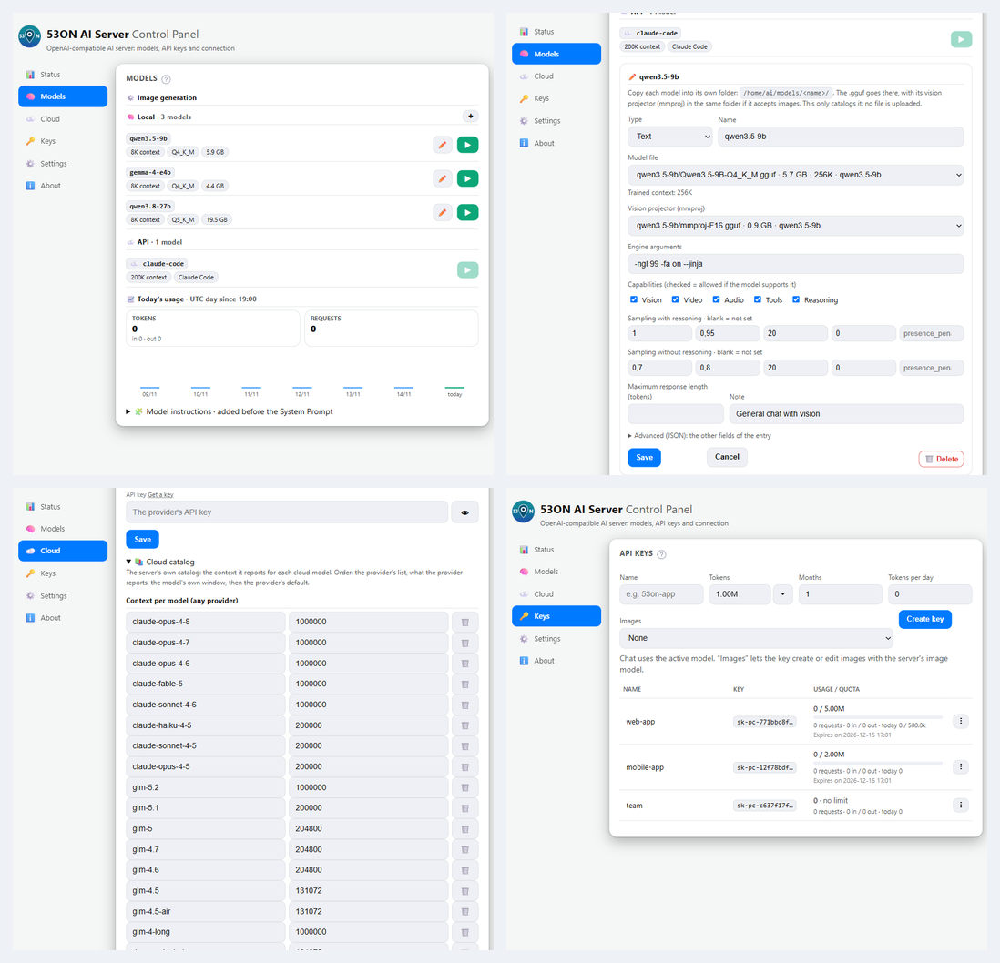

# 53ON AI Server: your local AI manager for text, image and video

**Run your own AI at home. A self-hosted, OpenAI-compatible AI manager on Ubuntu, built for AMD Ryzen AI Max (Strix Halo): text, image and video models on two local engines, llama.cpp and Strata, plus cloud providers and API keys, in one control panel.**

[](LICENSE) [](#recommended-setup-amd-ryzen-ai-max) [](#recommended-setup-amd-ryzen-ai-max) [](#quick-start) [](https://53on.com) [](https://paypal.me/enriqxmen)

A self-hosted manager that speaks the OpenAI and Anthropic APIs over two engines for text, [llama.cpp](https://github.com/ggml-org/llama.cpp) and [Strata](https://github.com/Niko1221/Strata), and makes pictures and clips with [stable-diffusion.cpp](https://github.com/leejet/stable-diffusion.cpp), with a control panel to load models, catalog them, relay cloud providers and hand out API keys with quotas. It has no dependencies: plain Node.js, one folder, one process.



> [!TIP]
> **Give your AI a memory and a body with [53ON Harness](https://github.com/53on/53on-harness).** It remembers between sessions, sees your screen, speaks, browses and works on your PC, and it uses this server as its model. Pair them and your AI runs entirely at home.
>
> [](https://github.com/53on/53on-harness/releases/latest) [](https://apps.apple.com/us/app/53on/id6758736136) [](https://play.google.com/store/apps/details?id=com.vcorps.five_three_on)

## Features

- **OpenAI and Anthropic compatible.** `/v1/chat/completions`, `/v1/completions`, `/v1/models` and `/v1/messages`, with streaming, tools and vision. `/v1/models` reports each model's `context_length` (what it serves) and `max_context_length` (its trained maximum).
- **Two engines: llama.cpp and Strata.** Each model's card picks its engine: llama.cpp (our build, or another build named on the card for a model that needs it) or [Strata](https://github.com/Niko1221/Strata), which runs models such as Inkling's looped layout. Load and stop each model from the panel; a model is never stopped while it answers, and its conversations are kept between loads. With either engine the chat sees a long prompt being read, live, and the panel shows each slot as it reads and writes.
- **Model catalog.** A folder is a model: copy its files into its own folder and add it with **+**. A text model brings its `.gguf` (or a quant subfolder such as `IQ3_XXS/`) with its vision projector and draft model; an image or video model brings its diffusion model, text encoder and VAE, `.gguf` or `.safetensors`, its parts one subfolder down. Pick the folder and the editor offers only that folder's files, one select per file the engine takes, taking a lone one by itself. The server reads the GGUF header (architecture and trained context), and the editor sets the type, title, engine arguments, capabilities (vision, video, audio, tools, reasoning), sampling, context window and the 🔓 uncensored label. Every card carries its own context window; one left blank takes the server's default. Picture and clip cards carry what each request sends (size, steps, cfg, sampler, scheduler, fps, frames) and a LoRA from the model's folder with its strength. A model is edited while it is stopped.
- **53ON's calibration.** For the models we run and tune (Qwen3.8 27B and Flash-Next, Qwen3.5 4B and 9B), add the `.gguf` and the editor fills its engine arguments, drafts, sampling, reasoning budget and answer length from [catalog.json](catalog.json).
- **Images and video.** Create and edit pictures, and film short clips with sound (MiniMax H3: from text, from a first and last frame, or from references), with [stable-diffusion.cpp](https://github.com/leejet/stable-diffusion.cpp). A text model draws by calling the `generate_image` tool and films by calling `generate_video`; to animate a picture, it names the one shown. A clip takes minutes, so it is a background job, as the industry does it: its link comes in the first status message, the clip is made and kept even if the client leaves, and the link answers `202` while it is made, `410` if it failed and the clip once it is there.
- **Cloud providers.** Relay Anthropic, OpenAI, Google, DeepSeek, Groq, Alibaba, OpenRouter and more through the same API. Provider keys stay on the server, and the server's own cloud catalog says the context of each cloud model.
- **API keys with plans.** Token quotas, monthly plans, daily caps, image permission, usage per key, export and import.
- **Live monitor.** GPU use and temperature, memory, power, and every request with who asked and its speed.
- **English and Spanish,** with help on every card, and a note in About when a newer release is out on GitHub.

## Quick start

Ubuntu 24.04 with Node.js 18 or newer:

```
git clone https://github.com/53on/53on-ai-server.git
cd 53on-ai-server
node server.js
```

The first start writes `config.json` from `config.example.json` and creates the admin token. It is printed once, on a line that reads `admin token (panel /admin): adm-…`, and it is kept in `config.json` as `admin_token`. Running as a service, read it with `journalctl -u ia-server | grep "admin token"`. Then:

1. Open `http://<server>:11500/admin` from the local network and enter the token.
2. **Settings › Engine:** choose *stable* or *newest*. The server downloads [our llama.cpp build](https://github.com/enriqxxx/llama.cpp/releases) into `~/engines`, verifies its sha256, tests it and switches to it.
3. **Models:** copy each model into its own folder, `~/models/<name>/`, with its companions beside it (for text, the `mmproj` if it sees images and the draft model if it has one; for images and video, the diffusion model, text encoder and VAE), then add it with **+** and pick its folder.
4. **Keys:** create a key for each client. Clients use `http://<server>:11500/v1` with that key.

To run it as a service, edit `User` and `WorkingDirectory` in [deploy/ia-server.service](deploy/ia-server.service) and install it:

```
sudo cp deploy/ia-server.service /etc/systemd/system/
sudo systemctl enable --now ia-server
```

## Recommended setup: AMD Ryzen AI Max

What we run on a Ryzen AI Max+ 395 mini PC with 128 GB of unified memory:

- **Ubuntu 24.04 LTS, headless, with the RAM freed for the models.** No desktop, and the services an AI box does not use are switched off:

  ```
  sudo systemctl set-default multi-user.target
  sudo systemctl disable --now snapd snapd.socket snapd.seeded upower unattended-upgrades ModemManager avahi-daemon cups bluetooth
  sudo systemctl mask --now fwupd
  sudo touch /etc/cloud/cloud-init.disabled
  ```

  With unattended upgrades off, security updates are applied by hand (`sudo apt update && sudo apt upgrade`), and any snap you still use stops with `snapd`.
- **96 GB for the GPU.** In the BIOS, set the UMA frame buffer to 96 GB, which leaves 32 GB to the system.
- **Kernel parameters.** Add them to `GRUB_CMDLINE_LINUX_DEFAULT` in `/etc/default/grub`, then `sudo update-grub` and reboot:

  ```
  amd_iommu=off amdgpu.lockup_timeout=10000,10000,10000,10000 ttm.pages_limit=27648000 ttm.page_pool_size=2097152
  ```

  `ttm.pages_limit` lets the GPU map about 105 GB of system memory, and the longer lockup timeout keeps a long prompt from being taken for a hang.
- **A recent Mesa for Vulkan (RADV).** `sudo add-apt-repository ppa:kisak/kisak-mesa && sudo apt upgrade`.
- **Our llama.cpp Vulkan build** (`ubuntu-vulkan-x64`), which the panel installs from **Settings › Engine**.
- **The service file in `deploy/`** keeps the server up if a model runs out of memory (`OOMPolicy=continue`) and stops the engines with it (`KillMode=mixed`).

## Our llama.cpp

The panel installs [our own llama.cpp build](https://github.com/enriqxxx/llama.cpp/releases), the one our AI runs on every day, built for Ubuntu 24.04 with Vulkan. It is upstream llama.cpp plus:

- **Dynamic VRAM.** The context memory grows with use, like a dynamic virtual disk, instead of being reserved whole at load: on Vulkan the KV cache and the compute buffers take memory in blocks as tokens arrive (sparse buffers, mapped directly on APUs), and on Linux the CPU path does the same. Measured on a Ryzen AI Max+ 395: a 1B model with a 1M-token window starts with 0.86 GiB instead of 8.24 GiB, and a 4B model at 262K with 4.41 GiB instead of 8.94 GiB.
- **Fair scheduling.** `--prefill-budget-busy` and `--spec-max-busy-slots`: a long prompt no longer starves the users who are already getting an answer.
- **Faster MoE on Vulkan without coopmat2** ([#27332](https://github.com/ggml-org/llama.cpp/pull/27332)): reads of 32-64 tokens 9-15 % faster on the Ryzen AI Max.
- **Slot save and restore with KV tensors over 1 GiB on Vulkan** ([#25584](https://github.com/ggml-org/llama.cpp/pull/25584)), needed for million-token windows.
- **Multimodal MTP for qwen4exp models** ([#30316](https://github.com/ggml-org/llama.cpp/pull/30316)): the draft model accepts image embeddings.

Each change is dropped as soon as upstream llama.cpp includes it. The server also runs any recent official build: to use one, stop the server and set `chat.engine` in `config.json` to `"name": "llama.cpp"` and `"repo": "ggml-org/llama.cpp"`.

## Strata, the second engine

[Strata](https://github.com/Niko1221/Strata) runs the models llama.cpp does not, such as Inkling's looped layout. Install it with its own installer and tune the model with it, then pick **Strata** as the engine on the model's card: the card names the run config Strata wrote (`strata_profile`) and its port when it is not 8091 (`strata_port`); `chat.strata_bin` in `config.json` says where `strata` lives when it is not on the `PATH`. The server starts `strata serve` with that run config, gives the model as many slots as its `parallel`, reads Strata's live block (`/metrics`) for the panel's slots and the chat's reading counter, and keeps Strata's own output in `strata-<model>.log`.

On a Ryzen AI Max (Strix Halo, `gfx1151`), Strata's only engine is the one for Inkling (`hip-halo`): as of Strata 0.1.66 its Qwen engine has HIP builds for the Radeon RX 6000, RX 7900 and RX 9070 only. `strata models import --plan` recognizes Qwen3.8 Flash-Next's files, but there is no engine to run them here, so on this machine Qwen models run on llama.cpp. Strata's edge with those big MoE models is spreading experts between RAM and a discrete GPU, which unified memory does not need. `strata update --check` tells what your machine gets.

## Configuration

Everything is set from the panel and saved to `config.json`; while the server runs, change it from the panel, not by hand. For HTTPS, put `fullchain.pem` and `privkey.pem` in `certs/`: the server then serves HTTPS on port 11500 and plain HTTP on 11501.

**Admin apps.** A local web tool of your own can sit behind the server's door. List it in `config.json` under `apps`, for example `"apps": [{ "path": "/tool", "port": 39000, "post": ["^/run$"] }]`, and it is served at `http://<server>:11501/tool/`, to the local network only and after the admin token (a small sign-in page sets a 12-hour cookie; `"open": true` drops the sign-in). GET requests pass through, event streams included; a POST passes only if its path matches one of the `post` patterns. There are none by default.

## Works with 53ON Harness

[53ON Harness](https://github.com/53on/53on-harness) gives your AI a memory that stays and hands, eyes and voice on your own PC, and it connects to this server as its model. The rest of 53ON, from WhatsApp answered by your AI to your own store, is at [53on.com](https://53on.com) and in the 53ON app for [iOS](https://apps.apple.com/us/app/53on/id6758736136) and [Android](https://play.google.com/store/apps/details?id=com.vcorps.five_three_on).

## Support

53ON AI Server is free. If it is useful to you, [buy us a coffee](https://paypal.me/enriqxmen) ☕: it helps us keep improving it.

## Acknowledgments

53ON AI Server stands on the work of others, and we thank them:

- [llama.cpp](https://github.com/ggml-org/llama.cpp) by ggml-org and its community, the first engine for text models here.
- [Strata](https://github.com/Niko1221/Strata) by Niko1221, the second engine for text models; its model library and file discovery inspired the catalog editor, and its design system (colors, spacing and components, MIT) gives the panel its look.
- [stable-diffusion.cpp](https://github.com/leejet/stable-diffusion.cpp) by leejet, the engine behind pictures and clips.
- [MiniMax H3](https://huggingface.co/MiniMaxAI/MiniMax-H3) by MiniMax, the open video model with sound the catalog is calibrated for.
- [LiteLLM](https://github.com/BerriAI/litellm), whose public table of model prices tells the server what each cloud request costs.
- The AMD Linux community: the Mesa RADV developers and the [kisak-mesa](https://launchpad.net/~kisak/+archive/ubuntu/kisak-mesa) PPA, which keep Vulkan fast on Ryzen AI Max.

## Security

- **The panel does not exist for the internet.** `/admin` and its API answer only private, loopback and VPN addresses; a request from the internet gets `404`, whether the router passes the visitor's address or its own. Behind a reverse proxy or a tunnel on the same machine every request looks local, so do not publish `/admin` through one.
- **Keys and tokens are random:** 96 bits for the admin token and 120 for each API key. Use HTTPS on the local network too, so they never travel in clear.
- **Clients cannot reach your network:** a picture URL is fetched only from public addresses, with its IP pinned and no redirects followed.
- **Claude Code, when enabled, runs with no tools,** so a client cannot make it read files or run commands.
- **Run it as an unprivileged user,** as `deploy/ia-server.service` does: whoever holds the admin token chooses the engine and its arguments.

If you find a vulnerability, please report it privately through this repository's Security tab ("Report a vulnerability") instead of opening a public issue.

## License

The code is [MIT](LICENSE). The 53ON name and logo are trademarks of VCORPS LLC and are not covered by that license: see [NOTICE](NOTICE).
